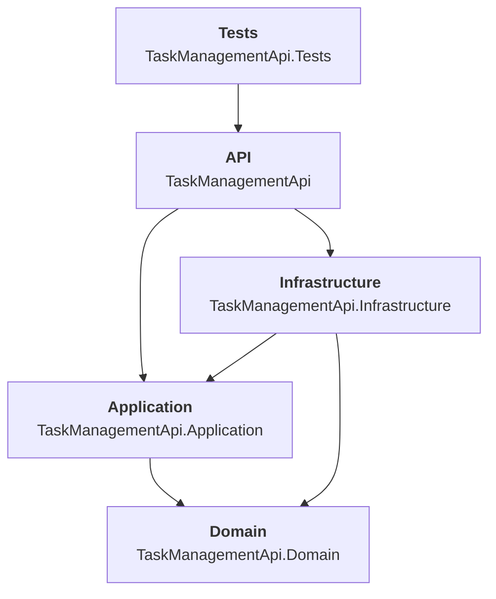
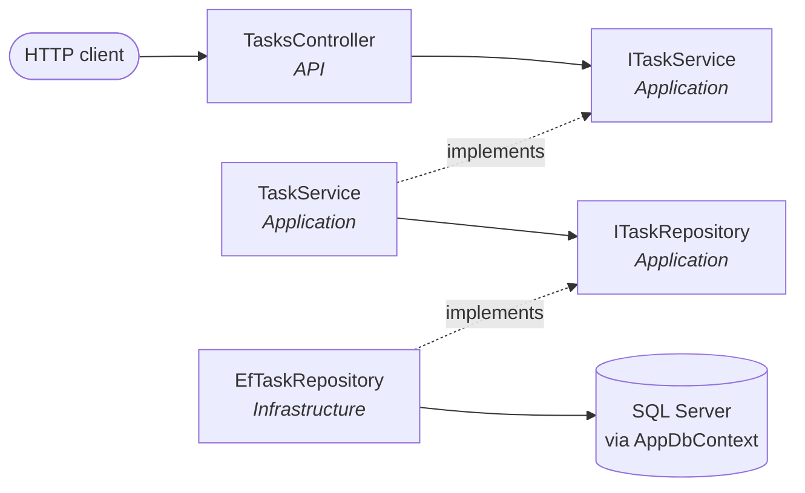

# Task Management REST API

ASP.NET Core Web API for managing tasks. Data is stored in SQL Server through EF Core, so it survives application restarts. Endpoints are protected with JWT bearer tokens and role-based policies; see [SECURITY.md](SECURITY.md) for details.

## Requirements
- .NET SDK 10
- SQL Server LocalDB (or another SQL Server)
- EF Core tool (install once):

```bash
dotnet tool install --global dotnet-ef
```

## Setup
Run from this folder (the one containing `TaskManagementApi.slnx`).

**1. Connection string**

It is in `TaskManagementApi/appsettings.json` under `ConnectionStrings:AppDbConnection`. The default uses LocalDB with Windows authentication, so it contains no password. To use another server, change it there.

**2. Set the JWT signing key (private, once per machine)**

The key that signs tokens is a secret, so it is **not** in `appsettings.json` or in git. Store it with .NET User Secrets, which keeps it in your user profile, outside the repository.

Generate a random key (at least 32 characters). Either of these works:

```bash
openssl rand -base64 48
```

```powershell
[Convert]::ToBase64String([System.Security.Cryptography.RandomNumberGenerator]::GetBytes(48))
```

The PowerShell command needs PowerShell 7 (`pwsh`). Then save the key:

```bash
dotnet user-secrets set "Jwt:SigningKey" "<paste-your-key-here>" --project TaskManagementApi
```

Check it with `dotnet user-secrets list --project TaskManagementApi`. In Visual Studio you can also right-click the `TaskManagementApi` project and choose **Manage User Secrets**, then add:

```json
{
  "Jwt:SigningKey": "<paste-your-key-here>"
}
```

`Jwt:Issuer` and `Jwt:Audience` are not secret and are already in `appsettings.json`. If any of the three values is missing, the app stops at startup with `Jwt:... is missing.`

User Secrets are only loaded in the `Development` environment. On a server, set the key as the environment variable `Jwt__SigningKey` (double underscore) or use a secret store.

**3. Create the database**

```bash
dotnet ef database update --project TaskManagementApi.Infrastructure --startup-project TaskManagementApi
```

This applies the migrations and adds starter data (2 projects, 2 users). Migrations live in the Infrastructure project, and the API project is the startup project because it holds the connection string.

**4. Run the API**

```bash
dotnet run --project TaskManagementApi
```

It listens on `http://localhost:5264` (and `https://localhost:7267` with the `https` profile). The launch profiles set `ASPNETCORE_ENVIRONMENT=Development`, which the token endpoint below needs.

**5. Get a token**

In Development, `POST /api/dev/token` returns a signed token for any user and role:

```bash
curl -X POST http://localhost:5264/api/dev/token -H "Content-Type: application/json" -d "{\"userId\": 1, \"role\": \"Manager\"}"
```

The response is `{ "token": "eyJ..." }`. Send it on protected requests:

```
Authorization: Bearer eyJ...
```

| Role | Can do |
|---|---|
| `Admin` | Everything, including deleting projects |
| `Manager` | Create, update, assign and delete any task |
| any other role, e.g. `User` | Create tasks; update only tasks assigned to them (their `userId`) |

Tokens expire after 30 minutes; request a new one when you get 401. The endpoint returns 404 outside Development, because it is a development-only issuer, not a real login.

## Reset the database
```bash
dotnet ef database drop --project TaskManagementApi.Infrastructure --startup-project TaskManagementApi
dotnet ef database update --project TaskManagementApi.Infrastructure --startup-project TaskManagementApi
```

> **Upgrading from an older version?** The migrations were recreated when the solution was split into layers. An existing `TaskManagementDb` will not update, so drop and recreate it with the commands above.

## Endpoints
| Method | Route | Who can call it | Success | Failure |
|---|---|---|---|---|
| POST | `/api/dev/token` | anyone, Development only | 200 with `{ token }` | 404 outside Development |
| GET | `/api/tasks` | anyone | 200 | none |
| GET | `/api/tasks/{id}` | anyone | 200 | 404 unknown ID |
| POST | `/api/tasks` | any valid token | 201 with `Location` header | 400 invalid body or unknown project |
| PUT | `/api/tasks/{id}` | `Manager`, `Admin`, or the task's assignee | 200 | 404 unknown ID, 400 invalid body or unknown project |
| PUT | `/api/tasks/{id}/assignee` | `Manager`, `Admin` | 200 | 404 unknown ID, 400 unknown user |
| DELETE | `/api/tasks/{id}` | `Manager`, `Admin` | 204 | 404 unknown ID |
| DELETE | `/api/projects/{id}` | `Admin` | 204 (also deletes the project's tasks) | 404 unknown ID |

Every endpoint except the anonymous ones also returns **401** without a valid token and **403** when the token's role or user is not allowed.

To assign or unassign a task, send `{ "assigneeId": 2 }` or `{ "assigneeId": null }` to `PUT /api/tasks/{id}/assignee`.

### Task fields
| Field | Notes |
|---|---|
| `title` | required, max 200 characters |
| `description` | required, max 800 characters |
| `status` | `0` Pending, `1` InProgress, `2` Completed |
| `priority` | `0` Low, `1` Medium, `2` High |
| `dueDate` | required, ISO 8601 date |
| `projectId` | required, must be an existing project |
| `assigneeId` | read-only in `POST` and `PUT`; set it with `PUT /api/tasks/{id}/assignee` |

### Task list: filters and paging
`GET /api/tasks?status=Pending&assigneeId=1&page=2&pageSize=5`

| Parameter | Default | Notes |
|---|---|---|
| `status` | none | `Pending`, `InProgress`, `Completed`. An unknown name returns 400 |
| `assigneeId` | none | Only tasks assigned to that user |
| `page` | 1 | Starts at 1. Values below 1 are treated as 1 |
| `pageSize` | 10 | Maximum 100. Larger values are capped at 100 |

The response contains `items`, `page`, `pageSize`, `totalCount` and `totalPages`. Filtering, counting and paging run in SQL, so the full table is never loaded into memory.

## Sample requests
`TaskManagementApi/TaskManagementApi.http` contains a request for every endpoint, plus the 404 and 400 cases. Update the host address at the top to match your port, then run the requests from Visual Studio or the VS Code REST Client extension.

Run the two login requests at the top (`managerLogin`, `userLogin`) first. The other requests read the token from their responses, so no token is ever pasted into the file. Run the logins again when requests start returning 401.

## SQL examples
`sql-examples.sql` contains the join, paging, grouping, foreign key and cascade queries.

## Architecture
The solution follows clean architecture with four projects. Dependencies point inward: Domain is at the center and depends on nothing.

### Project dependencies


An arrow means "references". There is no arrow out of Domain, and no arrow from Application to Infrastructure or API. `ArchitectureTests` checks both rules.

### Request flow


`TaskService` only knows the `ITaskRepository` interface. `Program.cs` connects the interfaces to their implementations through dependency injection.

- **Domain** contains the entities and enums only. It has no reference to EF Core or ASP.NET Core.
- **Application** contains the business logic, DTOs and the `ITaskRepository` interface. It reaches the database only through that interface.
- **Infrastructure** implements `ITaskRepository` with EF Core and SQL Server (`EfTaskRepository`), and holds `AppDbContext` and the migrations.
- **API** contains the controllers and wires everything together in `Program.cs`.

## Design
- `TasksController` is thin: it calls `ITaskService` and maps the result to a status code.
- `TaskService` holds the business logic and uses `ITaskRepository`, so it does not depend on EF Core.
- The service, the repository and `AppDbContext` are registered as scoped, so one request shares one `DbContext`.
- The service returns `null` or `false` for a missing task, and the controller turns that into 404.
- A task belongs to one project (required) and has an optional assignee.
- Deleting a project deletes its tasks. Deleting a user keeps their tasks and clears the assignee.
- Indexes: unique `Project.Name`, unique `User.Email`, and `Status`, `ProjectId` and `AssigneeId` on tasks. They are configured in `AppDbContext`, which keeps Domain free of EF Core attributes.
- IDs are generated by the database.
- Request validation uses DTO attributes, and `[ApiController]` returns 400 automatically.

## Architecture decisions
| Decision | Reason |
|---|---|
| Split into Domain, Application, Infrastructure and API projects | The compiler enforces the layers. Application code cannot use `AppDbContext` because the Application project does not reference Infrastructure. |
| `ITaskRepository` is defined in Application and implemented in Infrastructure | Business logic depends on an abstraction, not on EF Core (dependency inversion). The database could be replaced without changing `TaskService`. |
| One repository for tasks, with `ProjectExistsAsync` and `UserExistsAsync` on it | The service only needs existence checks for projects and users, so separate repositories for them would add code without benefit. |
| `SaveChangesAsync` is on the repository | The service decides when a unit of work is complete. With one repository, a separate unit-of-work interface is not needed yet. |
| `GetByIdAsync` and `GetByIdForUpdateAsync` are separate | Reads use `AsNoTracking` for speed. Updates and deletes need a tracked entity so EF Core can save the changes. |
| Indexes and relationships are configured in `AppDbContext`, not with attributes on entities | `[Index]` is an EF Core attribute. Keeping it out of Domain means Domain has no EF Core reference. |
| Validation attributes are on the Application DTOs | Validation belongs to the use case, not the HTTP layer. `[ApiController]` still runs it automatically and returns 400. |
| Reference checks (project and user exist) are in `TaskService` | They are business rules, so they live in Application. The service throws `InvalidReferenceException`, and the controller only maps it to 400. |
| Entities are mapped to `TaskResponseDto` in the service | Entities are never returned from the API, so their navigation properties and internal shape stay private. |
| Service, repository and `AppDbContext` are registered as scoped | A `DbContext` is not thread-safe and should live for one request. Everything that uses it has the same lifetime. |
| Public API behavior was kept unchanged | Routes, status codes and JSON shapes are the same as before the refactor. The integration tests, written before the split, still pass. |

## Tests
Integration and architecture tests, written with xUnit, are in `TaskManagementApi.Tests`.

```bash
dotnet test
```

Or use Test Explorer in Visual Studio. The tests use SQL Server LocalDB, so they run on Windows only.

### How the integration tests work
`ApiFactory` extends `WebApplicationFactory<Program>` and starts the real API in memory, so requests go through the full pipeline: routing, model validation, controllers, services, the repository and EF Core.

- **Separate database.** The factory replaces the app's `AppDbContext` registration with one that points to a new LocalDB database named `TaskApi_Test_<guid>`. Your real `TaskManagementDb` is never touched.
- **Real migrations.** On startup the factory runs `Database.Migrate()`, so the schema and seed data (projects 1 and 2, users 1 and 2) match production.
- **Cleanup.** When the tests finish, `DisposeAsync` deletes the test database.
- **One database per test class.** `TaskApiTests` uses `IClassFixture<ApiFactory>`, so its tests share one database. Tests create their own data and check only that data, so they do not depend on each other or on run order.

### Test files
| File | Purpose |
|---|---|
| `ApiFactory.cs` | Starts the API with a temporary test database and removes it afterwards |
| `TestTokens.cs` | Creates signed test tokens; optional parameters make expired, forged or wrong-issuer/audience tokens |
| `TaskApiTests.cs` | HTTP integration tests for `/api/tasks` |
| `TokenValidationTests.cs` | Bad tokens are rejected with 401 |
| `ProjectAuthTests.cs` | Only Admin can delete projects |
| `TaskAssignAuthTests.cs` | Only Manager and Admin can assign tasks |
| `TaskUpdateAuthTests.cs` | Per-user task update rule |
| `ArchitectureTests.cs` | Checks the dependency rules between layers |

The tests do not need your User Secrets. `ApiFactory` sets its own test-only issuer, audience and signing key, and `TestTokens` signs tokens with them.

### Integration tests (`TaskApiTests`)
| Test | Checks |
|---|---|
| `GetTasks_ReturnsOk` | `GET /api/tasks` returns 200 |
| `PostTask_ValidBody_ReturnsCreatedAndTaskCanBeFetched` | `POST` returns 201 with a `Location` header, and that location returns the task |
| `PostTask_InvalidBody_ReturnsBadRequest` | Empty title, blank title or unknown project returns 400 |
| `PostTask_MissingDueDate_ReturnsBadRequest` | A missing `dueDate` returns 400 |
| `UnknownId_ReturnsNotFound` | `GET`, `PUT` and `DELETE` on an unknown ID return 404 |
| `PutTask_Existing_ReturnsOkAndChangesAreSaved` | `PUT` returns 200 and the change is saved |
| `DeleteTask_Existing_ReturnsNoContentAndTaskIsGone` | `DELETE` returns 204 and the task is gone |
| `GetTasks_PageSizeOver100_IsCappedAt100` | `pageSize` above 100 is capped at 100 |
| `GetTasks_StatusFilter_ReturnsOnlyMatchingTasks` | `?status=Completed` returns only completed tasks |

### Authorization tests
| File | Tests | Expected |
|---|---|---|
| `TokenValidationTests` | no token, malformed, forged, expired, wrong issuer, wrong audience | 401 |
| | valid token | accepted |
| `ProjectAuthTests` | Admin / Manager / no token / unknown id deletes a project | 204 / 403 / 401 / 404 |
| `TaskAssignAuthTests` | Manager / Admin / User / no token assigns; unknown task; unknown user | 200 / 200 / 403 / 401 / 404 / 400 |
| `TaskUpdateAuthTests` | owner / other user / Manager / no token updates; unknown task | 200 / 403 / 200 / 401 / 404 |

### Architecture tests (`ArchitectureTests`)
| Test | Checks |
|---|---|
| `Domain_DoesNotReference_Application_Infrastructure_OrApi` | The Domain assembly does not reference Application, Infrastructure, the API project, EF Core or ASP.NET Core |
| `Application_DoesNotReference_Infrastructure_OrApi` | The Application assembly does not reference Infrastructure, the API project, EF Core or ASP.NET Core |

The tests read the assemblies each layer actually uses (`GetReferencedAssemblies()`), so they need no extra packages.

### Adding a new integration test
1. Add a `[Fact]` or `[Theory]` method to `TaskApiTests`.
2. Use `_client` to send requests.
3. Use `CreateTaskAsync(title, status)` when the test needs an existing task.
4. Assert on data your test created, not on total counts, because other tests in the class share the database.

### Troubleshooting
- **The app stops with `Jwt:SigningKey is missing.`:** you skipped setup step 2. Set the key with `dotnet user-secrets set`.
- **Every protected request returns 401:** the token is missing, expired (30 minutes) or was created by a run with a different signing key. Get a new one from `POST /api/dev/token`.
- **`POST /api/dev/token` returns 404:** the app is not running in `Development`. Use a launch profile, or set `ASPNETCORE_ENVIRONMENT=Development`.
- **All tests fail with `PendingModelChangesWarning`:** the model in `AppDbContext` changed without a migration. Add one:
  ```bash
  dotnet ef migrations add <Name> --project TaskManagementApi.Infrastructure --startup-project TaskManagementApi
  ```
- **Cannot connect to `(localdb)\mssqllocaldb`:** check that LocalDB is installed and running with `sqllocaldb info mssqllocaldb`.
- **Leftover `TaskApi_Test_*` databases:** they can remain if a test run is stopped halfway. Delete them in SQL Server Object Explorer.

## Project layout
```
TaskManagementApi/
├─ TaskManagementApi.slnx
├─ README.md
├─ SECURITY.md                        authentication, authorization and secrets
├─ sql-examples.sql
├─ TaskManagementApi/                 API: controllers, Authorization/, Program.cs, appsettings
├─ TaskManagementApi.Application/     DTOs, services, ITaskRepository, exceptions
├─ TaskManagementApi.Domain/          entities and enums
├─ TaskManagementApi.Infrastructure/  AppDbContext, migrations, EfTaskRepository
└─ TaskManagementApi.Tests/           integration and architecture tests
```
